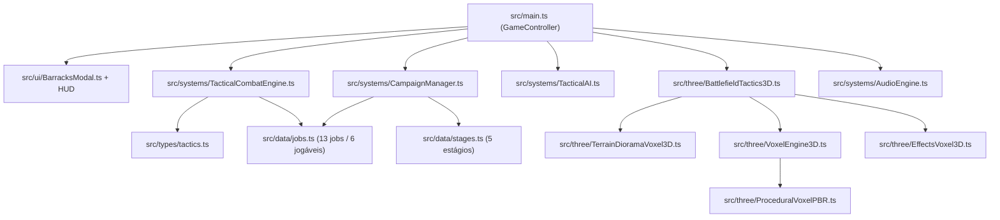

# Arquitetura — CROWN OF ASHES: VOXEL TACTICS

**Fonte de verdade:** Código-fonte em `src/`, `tests/tactics.test.mjs` e grafo AST em `graphify-out/GRAPH_REPORT.md` (`2.909` nós e `4.256` arestas — nota: inclui scripts auxiliares presentes no diretório `.agents/skills/` rastreado pelo repositório).

---

## 1. Separação Domínio vs. Apresentação 3D

A arquitetura desacopla as regras puras de RPG tático (`src/systems/`, `src/data/`, `src/types/tactics.ts`) da camada de visualização Three.js (`src/three/` e `src/main.ts`):

---

## 2. Módulos Principais

- **`src/systems/TacticalCombatEngine.ts` (1.439 linhas):** Implementa busca de tiles alcançáveis (`MoveNode`), previsão de combate (`CombatForecast`), resolução de ataques/magias em área (`ActionExecutionResult`), direção de ataque (frente/flanco/costas), vantagem de altura, knockback com dano de queda, status effects e baús.
- **`src/systems/CampaignManager.ts`:** Gerencia o estado persistente da campanha (`CampaignSaveData` v1 com chave primária e backup em `localStorage`), abstraído via interface `StorageLike` (`MemoryStorage` para execução headless em Node/testes).
- **`src/three/VoxelEngine3D.ts` (1.058 linhas):** Constrói rigs hierárquicos de micro-voxels (`CharacterVoxelRig` com pivôs de cabeça, torso, braços, arma, escudo, capa, pernas, grimório, runas orbitantes e arco) e executa máquina de estados de animação (`idle`, `walk`, `slash`, `bow`, `dual`, `cast`, `jump_up`, `jump_down`, `hit`, `block`, `dead`).
- **`src/three/ProceduralVoxelPBR.ts` & `TerrainDioramaVoxel3D.ts`:** Materiais PBR procedurais para cada `VoxelMaterialKind` e geração do diorama 3D por bioma e elevação.
- **`src/three/BattlefieldTactics3D.ts` & `EffectsVoxel3D.ts`:** Orquestram câmera isométrica/orbital, seleção de células, animações de deslocamento/ataque e partículas voxel.

---

## 3. Pontos de Atenção para Evolução

- Os testes em `tests/tactics.test.mjs` executam diretamente contra os módulos de sistema sem depender de WebGL/DOM graças ao `MemoryStorage` e à pureza de `TacticalCombatEngine.ts`.
- Otimizações de draw calls em `TerrainDioramaVoxel3D.ts` e `EffectsVoxel3D.ts` (como pooling e `InstancedMesh`) devem manter idêntica a interface pública consumida por `BattlefieldTactics3D.ts` e `main.ts`.
